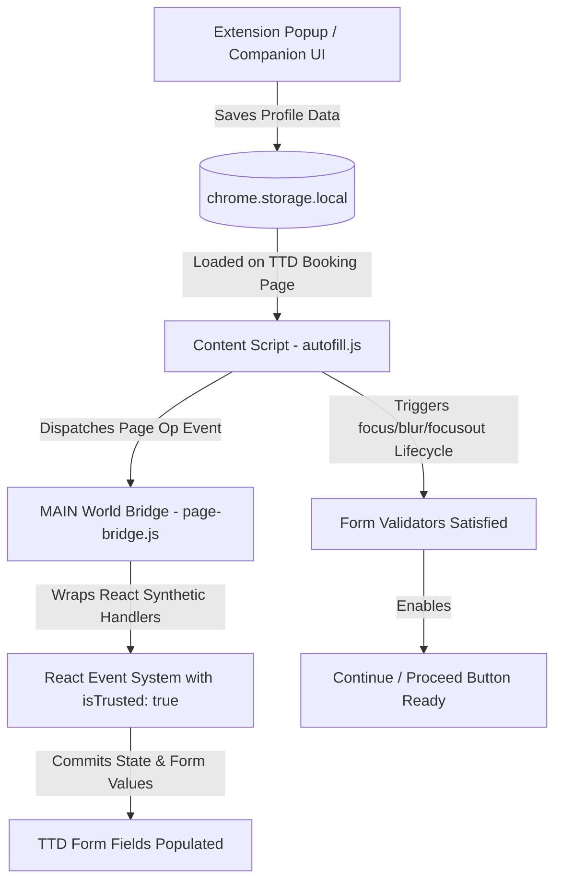

# 🛕 TTD Express Autofill — Fast Booking Companion

[](https://developer.chrome.com/docs/extensions/mv3/intro/)
[](https://github.com/pradeep-nv/ttd-express-autofill)
[](#-how-to-install)
[](LICENSE)
[](https://github.com/pradeep-nv/ttd-express-autofill)

A high-performance **Chrome Extension (Manifest V3)** designed to help devotees pre-save pilgrim profiles and automatically autofill high-traffic booking forms in milliseconds on the official Tirumala Tirupati Devasthanams (TTD) portals ([`ttdevasthanams.ap.gov.in`](https://ttdevasthanams.ap.gov.in) and [`tirupatibalaji.ap.gov.in`](https://tirupatibalaji.ap.gov.in)).

---

## ⚡ Why Use TTD Express Autofill?

During official TTD quota releases (Special Entry Darshan ₹300, Srivani Trust, Arjitha Seva, Srivari Seva, Accommodation, and Angapradakshinam), slots fill up in under **60 to 90 seconds**. Manually typing details for up to 6 devotees with Aadhaar/Passport numbers, dates of birth, addresses, and contact info under pressure often leads to session timeouts or quota exhaustion.

**TTD Express Autofill** eliminates manual typing by safely injecting pre-saved profiles into the booking form in under **100 milliseconds**, letting you focus immediately on solving the Captcha and proceeding to payment.

---

## ✨ Features & Capabilities

* **⚡ 1-Click Instant Autofill:** Populates primary and accompanying devotees (up to 6 pilgrims) with a single click.
* **🛡️ MAIN-World React Page Bridge (`page-bridge.js`):** Fully compatible with modern TTD portal updates where standard DOM events are dropped if `nativeEvent.isTrusted !== true`. Operates inside the page's MAIN execution context to wrap React synthetic event handlers so fields commit reliably without being wiped.
* **🔄 React 17+ Focusout & Validation Cleared:** Drives genuine `focus` → `blur` and bubbling `focusout` event sequences so Angular and React validators register valid data and enable the **Continue / Proceed** button immediately.
* **📍 Complete Contact & Address Auto-Population:** Fills Primary Devotee details including Email, Mobile Number, City, State (with support for all 36 Indian States and Union Territories), Pincode, and Gothram.
* **🛂 Aadhaar & Passport / NRI Support:** Handles domestic Aadhaar details as well as NRI / Foreign Passport devotee details (Country of Origin, Visa Number, Visa Type, and Visa Validity Date).
* **🗂️ Pilgrim Sets & Family Vault:** Organize family members and groups into customizable sets (e.g., *"Parents"*, *"Family"*, *"Pilgrimage Group"*) to load with one click.
* **🧪 Included Offline Test Portal (`demo_portal/index.html`):** Test and practice the full autofill workflow offline anytime before quota release day without needing an active TTD session.
* **🔒 100% Offline & Private:** Devotee information is stored strictly within your browser's local sandbox (`chrome.storage.local`). Zero remote servers, zero cloud syncing, zero telemetry.
* **💾 Client-Side Encrypted Backup:** Export and import pilgrim vault data using client-side AES-GCM encryption with a custom passphrase.
* **🌐 Multilingual UI:** Fully localized in 6 languages: English, Telugu (తెలుగు), Tamil (தமிழ்), Kannada (ಕನ್ನಡ), Malayalam (മലയാളം), and Hindi (हिन्दी).
* **🆓 100% Free & Open Source:** No paywalls, no recurring subscriptions, and no hidden telemetry.

---

## 🛠️ How It Works (Architecture)



1. **Local Vault**: Pilgrim profiles (Name, Age, Gender, ID Type, ID Number, Address, Contact) are saved in the browser's sandboxed storage (`chrome.storage.local`).
2. **Page Bridge Injection**: When visiting supported TTD URLs or the local demo portal, `content/page-bridge.js` is injected into the page's `MAIN` execution world at `document_start`.
3. **Form Detection & Mapping**: The content script automatically detects TTD table inputs, dropdowns, radio buttons, and contact inputs.
4. **React State Commitment**: The bridge safely triggers React component state updates and dispatches `focusout` events, preventing forms from wiping values or showing *"This field is required"*.

---

## 📂 Project Structure

```text
ttd-express-autofill/
├── manifest.json                 # Extension Manifest V3 configuration
├── service-worker-loader.js      # Background service worker entry point
├── LICENSE                       # MIT License
├── README.md                     # Documentation & setup guide
├── icon-16.png                   # 16x16 toolbar icon
├── icon-32.png                   # 32x32 icon
├── icon-48.png                   # 48x48 icon
├── icon-128.png                  # 128x128 store & management icon
├── icon.svg                      # Scalable SVG vector master icon
├── _locales/                     # Multilingual i18n support
│   ├── en/messages.json          # English
│   ├── hi/messages.json          # Hindi (हिन्दी)
│   ├── kn/messages.json          # Kannada (ಕನ್ನಡ)
│   ├── ml/messages.json          # Malayalam (മലയാളം)
│   ├── ta/messages.json          # Tamil (தமிழ்)
│   └── te/messages.json          # Telugu (తెలుగు)
├── assets/                       # Bundled React application & core autofill engine
│   ├── autofill.js-CMTxtjwz.js   # Fast autofill content script engine
│   ├── service-worker.js-*       # Background service worker
│   ├── index.html-*.js           # Popup & Options application bundles
│   └── styles-*.css              # Companion & popup stylesheets
├── content/                      # Content scripts & bridge
│   ├── page-bridge.js            # MAIN-world React synthetic event bridge
│   ├── content.js                # Vanilla content script fallback
│   ├── content.css               # In-page widget & highlight styling
│   └── field_mappings.js         # TTD portal DOM selector dictionaries
├── demo_portal/                  # Offline test sandbox
│   └── index.html                # Mock TTD booking portal for instant testing
├── popup/                        # Standalone popup interface
│   ├── popup.html
│   ├── popup.js
│   └── popup.css
├── options/                      # Standalone options & settings interface
│   ├── options.html
│   ├── options.js
│   └── options.css
└── src/                          # Entry points for extension action & companion
    ├── popup/index.html
    └── options/index.html
```

---

## 🚀 How to Install

### Method: Load Unpacked in Developer Mode

1. **Clone or Download** this repository to your computer:
   ```bash
   git clone https://github.com/pradeep-nv/ttd-express-autofill.git
   ```
   *(Or download the ZIP file from GitHub and extract it to a folder).*

2. Open your Chromium-based browser (**Google Chrome**, **Microsoft Edge**, **Brave**, or **Opera**).

3. Navigate to the extensions manager:
   - **Chrome / Brave:** `chrome://extensions`
   - **Microsoft Edge:** `edge://extensions`
   - **Opera:** `opera://extensions`

4. Toggle **Developer mode** on (top-right corner).

5. Click **Load unpacked** (top-left corner).

6. Select the `ttd-express-autofill` folder.

7. Pin the extension to your browser toolbar for quick access! 🛕

---

## 🧪 Testing with the Local Demo Portal

You can test the full autofill experience right away without waiting for TTD quota drops:

1. In your browser, open the included offline demo portal:
   - Open a new tab and press `Ctrl + O` (or `Cmd + O` on Mac).
   - Navigate to the project folder and select `demo_portal/index.html`.
   *(Or navigate directly to `file:///path/to/ttd-express-autofill/demo_portal/index.html`)*.
2. Click the **TTD Express Autofill** icon in your toolbar.
3. Add 1 to 6 sample pilgrims and enter contact details (Email, State, City, Pincode).
4. Click **⚡ Fill All Details**.
5. Watch the table and contact inputs populate automatically in milliseconds!

---

## 📖 Booking Day Workflow

### Step 1: Pre-Configure Profiles Before Quota Drops
1. Click the **TTD Express Autofill** icon on your browser toolbar.
2. Open **Manage / Settings** to enter the companion dashboard.
3. Add your family members / devotees:
   - Full Name (exactly as printed on Govt ID)
   - Age & Gender
   - ID Type (Aadhaar or Passport) & ID Number
   - Contact Details (Email, State, City, Pincode, Mobile)
4. Save your profiles or group them into a **Pilgrim Set**.

### Step 2: On Quota Release
1. Log in to [ttdevasthanams.ap.gov.in](https://ttdevasthanams.ap.gov.in) before the quota release time.
2. Select your Darshan / Seva date, slot, and number of persons.
3. Once the devotee details page loads:
   - Click the extension icon and click **⚡ Fill All Details**.
   - Devotee names, ages, genders, ID proofs, and contact details will fill instantly.
4. Enter the **Captcha** manually.
5. Click **Continue / Proceed to Payment**.

---

## 🛡️ Privacy & Security Disclosure

* **Zero Cloud Storage:** All pilgrim records, Aadhaar numbers, and phone numbers remain strictly inside your browser's local sandbox (`chrome.storage.local`).
* **Zero Tracking / Analytics:** No analytics tags, external tracking scripts, or ad networks are included.
* **Client-Side Export:** Encrypted backups are generated purely in your browser using standard Web Crypto APIs (`AES-GCM` with `PBKDF2`).
* **Permissions Justification:**
  - `storage`: Required to store pilgrim profiles and preferences on your device.
  - `activeTab`: Required to interact with the active TTD booking tab when you click autofill.
  - `alarms`: Used for scheduled state maintenance tasks.

---

## ⚠️ Disclaimer

This extension is an independent, open-source productivity utility developed to assist devotees. It is **not affiliated, associated, authorized, endorsed by, or in any way officially connected** with Tirumala Tirupati Devasthanams (TTD) or the Government of Andhra Pradesh. All official TTD services, marks, and names belong to their respective owners. This tool does not bypass Captchas, queues, or payment systems.

---

## 📧 Support & Feedback

If you encounter any issues or have feature requests, please reach out:
* **Support Email:** [virat1sj20@gmail.com](mailto:virat1sj20@gmail.com)
* **GitHub Issues:** [https://github.com/pradeep-nv/ttd-express-autofill/issues](https://github.com/pradeep-nv/ttd-express-autofill/issues)

---

## 📄 License

This project is open source and available under the [MIT License](LICENSE).
