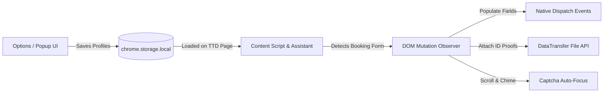

# 🛕 TTD Express Autofill — Fast Booking Companion

[](https://developer.chrome.com/docs/extensions/mv3/intro/)
[](https://github.com)
[](#)
[](LICENSE)

A high-performance **Chrome Extension (Manifest V3)** designed to help devotees pre-save pilgrim profiles and automatically autofill high-traffic booking forms in milliseconds on the official Tirumala Tirupati Devasthanams (TTD) portal (`ttdevasthanams.ap.gov.in` / `tirupatibalaji.ap.gov.in`).

---

## ⚡ Why Use TTD Express Autofill?

During TTD quota releases (Special Entry Darshan, Srivani, Arjitha Seva, Accommodation), slots fill up in under 60–90 seconds. Manually typing details for 4–6 pilgrims with ID cards and uploading photo proofs usually causes timeouts. 

This extension eliminates manual typing and file selection by automating the entire form-filling process in under **100 milliseconds**.

---

## ✨ Features & Capabilities

* **⚡ 1-Click & Instant Autofill:** Automatically populates primary and accompanying devotees (up to 6 pilgrims) in a single click.
* **⚛️ Framework Safe (React & Angular):** Employs native JavaScript property descriptors and event dispatching (`input`, `change`, `blur`) ensuring modern web form validators never fail.
* **📎 Automatic Photo & ID Attachment:** Automatically converts saved ID proof scans and attaches them to `<input type="file">` elements using the HTML5 `DataTransfer` API.
* **🎛️ Draggable In-Page Assistant:** A floating, non-intrusive widget on the booking page with **1-Click Fill**, **Focus Captcha**, and live devotee status indicators.
* **🎯 Smart Captcha Focus & Audio Alert:** Scrolls instantly to the Captcha field, focuses the cursor, and sounds an alert chime so you can type the Captcha immediately.
* **☑️ Auto-Accept Terms:** Automatically checks mandatory T&C disclaimers and declarations.
* **🔒 100% Offline & Private:** Devotee data, Aadhaar details, and photos are stored exclusively inside your browser's local sandbox (`chrome.storage.local`). Zero remote servers, zero tracking.
* **💾 Backup & Restore:** Export and import family pilgrim profiles as JSON across multiple devices or browsers.
* **🌐 Multilingual UI:** Supports English, Telugu (తెలుగు), Tamil (தமிழ்), Kannada (ಕನ್ನಡ), and Malayalam (മലയാളം).

---

## 🛠️ How It Works (Technical Breakdown)



1. **Local State Management**: Pilgrim details (Name, Age, Gender, ID Type, ID Number, Photo Proof) are saved encrypted in browser storage via `chrome.storage.local`.
2. **DOM Observer & Dynamic Mapping**: The extension injects an isolated content script into matching TTD booking pages. A MutationObserver monitors dynamic form fields rendered by Angular/React.
3. **Event Dispatching**: Fields are filled by triggering real DOM events (`new Event('input', { bubbles: true })`) so frontend validation rules mark fields as valid.
4. **Base64 to File Conversion**: Saved image files are decoded into `Blob` and `File` objects and injected into file input elements.

---

## 🚀 How to Install

### For Users (Download ZIP)
1. Download the latest `ttd-autofill-v*.zip` from the **[Releases](https://github.com/)** section.
2. **Extract (Unzip)** the downloaded file to a folder on your computer.
3. Open your Chromium browser (**Google Chrome**, **Microsoft Edge**, **Brave**, or **Opera**).
4. Navigate to:
   ```
   chrome://extensions
   ```
   *(Or `edge://extensions` if using Microsoft Edge)*
5. Turn **ON** the **Developer mode** toggle in the top-right corner.
6. Click **Load unpacked** in the top-left corner.
7. Select the unzipped folder. The extension icon will appear in your browser toolbar!

---

## 📖 How to Use

### Step 1: Pre-Configure Pilgrim Profiles
1. Click the **TTD Assistant** icon in your browser toolbar.
2. Click **Manage** (or open extension Options).
3. Fill in the details for each family member / devotee:
   - Full Name (as per Govt ID)
   - Age & Gender
   - ID Proof Type (Aadhaar, Passport, Voter ID, etc.)
   - ID Number
   - Optional: Upload ID Photo proof.
4. Click **💾 Save Changes**.

### Step 2: Booking Day Workflow
1. Log into the [TTD Booking Portal](https://ttdevasthanams.ap.gov.in) when quota opens.
2. Select your Darshan date, time slot, and number of pilgrims.
3. When the pilgrim details page appears:
   - Click **⚡ 1-Click Autofill** on the floating widget on the screen (or in the extension popup).
   - All devotee names, ages, IDs, and proofs will be filled instantly.
4. Solve the **Captcha** (the cursor is already positioned there!).
5. Click **Proceed to Payment**.

---

## 🛡️ Privacy & Security Disclosure

* **No Analytics / Telemetry:** We do not track, collect, or store any user browsing activity.
* **No Cloud Servers:** All pilgrim data is stored 100% locally on your computer inside `chrome.storage.local`.
* **Open Source:** You can inspect all source code inside this repository to verify its integrity.

---

## ⚠️ Disclaimer

This extension is an independent, open-source productivity tool developed to assist devotees. It is **not affiliated, associated, authorized, endorsed by, or in any way officially connected** with Tirumala Tirupati Devasthanams (TTD) or the Government of Andhra Pradesh. All official TTD services, names, and marks belong to their respective owners.

---

## 📄 License
This project is licensed under the [MIT License](LICENSE).
